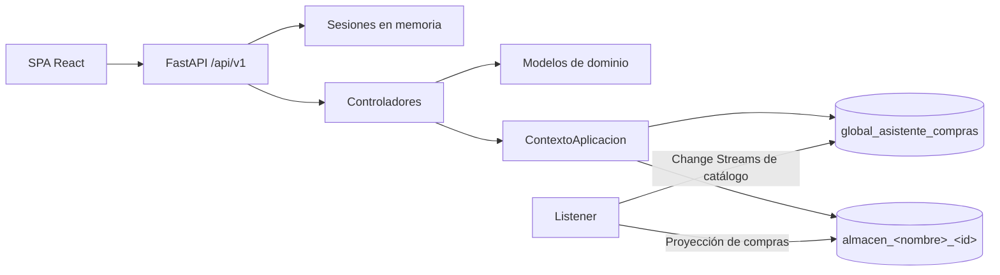
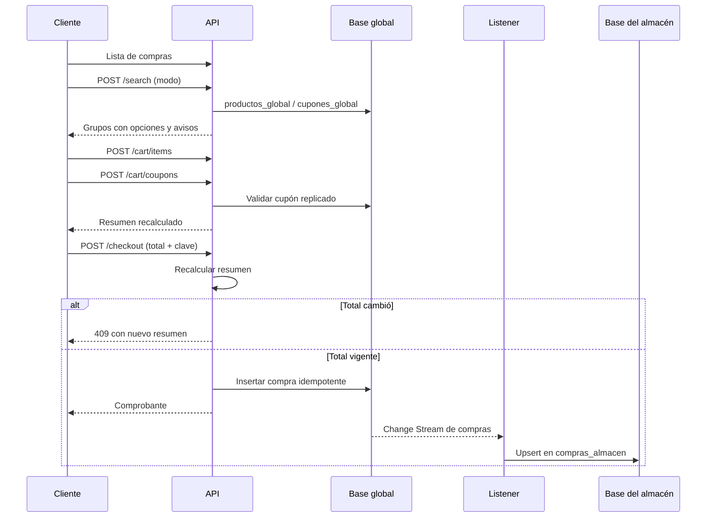

# Arquitectura del Asistente de Compras

## 1. Vista general

La aplicación es una SPA de React servida por la misma API FastAPI. La
persistencia se separa en una base global y una base dedicada por almacén,
conectadas mediante **Change Streams** sobre MongoDB en replica set.



La API no depende de que el listener esté vivo. La consistencia entre la base
global y las bases de almacén es **eventual** y se puede reparar con los scripts
de reconciliación.

## 2. Capas

| Capa | Directorio | Responsabilidad |
| --- | --- | --- |
| Vista | `views/api/` | FastAPI, validación Pydantic, autenticación Bearer, errores HTTP y servido de la SPA. |
| Controlador | `controllers/` | Casos de uso, permisos y coordinación del carrito, compras y administración. |
| Modelo | `models/` | Entidades, validaciones, carrito y reglas de presentación. |
| Infraestructura | `infrastructure/mongodb/` | Conexiones por rol, repositorios, aprovisionamiento, validación y replicación. |
| Núcleo | `core/` | Configuración por entorno, errores y logging. |

Dependencias:

```text
views -> controllers -> models
controllers -> infrastructure -> MongoDB
listener (scripts/run_listener.py) -> infrastructure -> MongoDB
```

La vista no accede a MongoDB y los controladores no dependen de FastAPI.

## 3. Roles y autenticación

Roles de aplicación:

- `CLIENTE`: registro público, lista, búsqueda, carrito, cupones y pago.
- `ADMINISTRADOR_ALMACEN`: productos, CSV, cupones, compras y estadísticas de su
  almacén.
- `ADMINISTRADOR_APP`: almacenes y administradores de almacén.

El login es único. La API devuelve un `session_id` que el cliente envía como
`Authorization: Bearer <session_id>`. Las dependencias de FastAPI comprueban el
rol en cada endpoint; ocultar botones en la interfaz no sustituye esta validación.

La cuenta inicial del administrador de la aplicación se crea en
`RepositorioUsuarios.asegurar_admin()` solo si no existe ningún usuario con rol
`ADMINISTRADOR_APP`. El correo y la contraseña provienen de `ADMIN_EMAIL` y
`ADMIN_PASSWORD`.

> Las sesiones y los carritos se guardan en memoria del proceso. Por eso la API
> se ejecuta con un solo worker y las sesiones se pierden al reiniciar. Es una
> decisión consciente para esta versión.

### Roles nativos de MongoDB

Las URIs se construyen en `FabricaURIs` y solo las usa el backend. Nunca se
serializan, registran ni envían al frontend.

| Usuario | Rol nativo | Uso |
| --- | --- | --- |
| `cliente_app` | `rol_cliente` | Catálogo global, cupones y compras del cliente. |
| `admin_app` | `rol_admin_app` | Metadata de almacenes y lectura de catálogo global. |
| `auth_service` | `rol_auth` | Colección `usuarios`. |
| `validador_catalogo` | `rol_validador` | Lectura global para validar presentación y cupones. |
| `replicador_catalogo` | `rol_catalogo` | Change Streams de catálogo y escritura de la réplica global. |
| `proyector_compras` | `rol_proyector` | Change Stream de compras y escritura de `compras_almacen`. |
| `provisioner` | `userAdminAnyDatabase`, `dbAdminAnyDatabase` | Crear bases, roles, usuarios e índices por almacén. |

Un único usuario MongoDB atiende a todos los clientes. Cada almacén recibe un
usuario nativo propio (`almacen_<nombre>_<id>_app`) con el rol `rol_almacen`, que
solo puede operar sobre las colecciones de su base. Todos los administradores de
un mismo almacén comparten ese usuario.

La contraseña del usuario de cada almacén se deriva con HMAC-SHA256 a partir de
`MONGODB_WAREHOUSE_SECRET` y del `almacen_id`. No se almacena en texto plano ni se
reutiliza entre almacenes. Cambiar el secreto exige ejecutar
`scripts/rotar_secretos_almacenes.py`.

Los roles globales, usuarios de servicio e índices se crean con los scripts de
`infrastructure/mongodb/init/`:

| Script | Contenido |
| --- | --- |
| `00_replica_y_root.js` | Inicia el replica set y crea el usuario root. |
| `10_roles.js` | Crea o actualiza los roles globales. |
| `20_usuarios.js` | Crea o actualiza los usuarios de servicio. |
| `30_indices.js` | Asegura los índices de la base global. |

Los privilegios de `rol_catalogo` y `rol_proyector` sobre una base de almacén se
agregan dinámicamente al aprovisionar el almacén.

## 4. Modelo de datos

### Base global `global_asistente_compras`

```text
global_asistente_compras
├── usuarios
├── almacenes
├── productos_global
├── cupones_global
├── compras
├── sync_state_catalogo
└── sync_state_compras
```

#### `usuarios`

Campos principales: `_id`, `nombre`, `email`, `email_normalizado`,
`password_hash`, `rol`, `almacen_id`, `telefono`, `direccion`, `ciudad`,
`autoriza_datos`, `activo` y `creado_en`.

- `email_normalizado` es único (`email_unico`).
- `(rol, almacen_id)` tiene índice `rol_almacen`.
- Las contraseñas se guardan con PBKDF2-HMAC-SHA256 y salt aleatorio.
- Un administrador de almacén tiene exactamente un `almacen_id`.

#### `almacenes`

`_id`, `nombre`, `nombre_normalizado`, `db_name`, `mongo_user`, `estado` y
`creado_en`. Los campos `db_name`, `mongo_user` y `estado` son metadata interna y
nunca se serializan en la API.

- `nombre_normalizado` es único (`nombre_unico`).
- `db_name` es único (`db_unica`) y `mongo_user` es único (`usuario_unico`).
- `estado` pasa por `creando`, `activo` y `error`.
- No se editan ni eliminan desde la aplicación.

#### `productos_global`

Réplica de solo lectura para el cliente del catálogo de todos los almacenes.
Conserva los mismos campos que el producto de origen e índices por tipo, precio,
almacén, presentación y `producto_id`.

#### `cupones_global`

Réplica de los cupones para que el cliente los consulte y aplique. `_id` es el
`cupon_id` del almacén, `codigo_normalizado` es único en toda la aplicación
(`codigo_unico`) y `almacen_id` tiene índice.

#### `compras`

`_id`, `cliente_id`, `clave_idempotencia`, `cliente_nombre`, `datos_entrega`,
`items`, `por_almacen`, `subtotal`, `descuento_total`, `total`,
`autorizacion_datos`, `pago` y `fecha`.

- `(cliente_id, clave_idempotencia)` es único (`idempotencia`).
- `(items.almacen_id, fecha)` tiene índice `almacen_fecha`.
- `items` es una copia inmutable de nombre, presentación, precio, cantidad e
  importe.
- `por_almacen` conserva subtotal, cupón, porcentaje, descuento y total de cada
  almacén.
- `datos_entrega` conserva nombre, teléfono, dirección y ciudad confirmados.

#### Estado de sincronización

- `sync_state_catalogo`: un documento por almacén y colección con el token de
  reanudación (`resume_after`) y el estado del sincronizador.
- `sync_state_compras`: token del Change Stream de `compras` y estado del
  proyector.

### Base de un almacén `almacen_<nombre>_<id>`

```text
almacen_<nombre>_<id>
├── productos
├── cupones
└── compras_almacen
```

#### `productos`

`_id`, `almacen_id`, `tipo_producto`, `tipo_normalizado`, `nombre`,
`nombre_normalizado`, `marca_variedad`, `marca_normalizada`, `precio`,
`presentacion`, `presentacion_normalizada`, `creado_en` y `actualizado_en`.

Índices:

- `(almacen_id, tipo_normalizado)`
- `(tipo_normalizado, precio)`
- `presentacion_normalizada`

La presentación se valida contra todos los productos del mismo
`tipo_normalizado`, incluso de otros almacenes. Si ya existe una presentación
estándar para el tipo, cualquier alta o edición debe usarla.

#### `cupones`

`_id`, `codigo`, `codigo_normalizado` único dentro del almacén, `almacen_id`,
`porcentaje` y `creado_en`. El porcentaje debe estar en `(0, 100]`. La unicidad
global del código se valida además contra `cupones_global` con la conexión de
solo lectura.

#### `compras_almacen`

Proyección de la parte de cada compra que corresponde al almacén. Contiene
`compra_id`, `cliente_id`, `cliente_nombre`, `fecha`, datos de entrega, los
`items` del almacén, `subtotal`, cupón, descuento y total. Índices por
`compra_id` y por `fecha`.

## 5. Conexiones y contexto

`construir_contexto(settings)` es el único punto de cableado:

1. `FabricaURIs` construye la URI de cada rol y de cada almacén.
2. `ConexionesMongo` reutiliza un `MongoClient` por URI y abre las bases de forma
   perezosa.
3. Cada repositorio recibe una `Database` ya construida con la conexión de su
   rol. Así el aislamiento se respeta también en el código.
4. `DirectorioAlmacenes` resuelve la metadata de un almacén y construye su
   `RepositorioAlmacen`.
5. `ServicioAprovisionamiento` crea roles, usuarios e índices al dar de alta un
   almacén.
6. `ServicioValidacion` usa la conexión de solo lectura para las reglas globales.
7. `SincronizadorCatalogo` y `ProyectorCompras` se ejecutan en el proceso
   `listener`.

En `modo_pruebas`, `FabricaURIs` devuelve el mismo `MONGODB_URI` para todas las
conexiones. Los repositorios siguen usando nombres de base distintos, de modo que
el aislamiento lógico se puede probar sin crear usuarios nativos.

## 6. Aprovisionamiento de un almacén

`ServicioAprovisionamiento.crear_almacen()`:

1. Normaliza el nombre y comprueba que no exista otro almacén con el mismo
   nombre normalizado.
2. Genera `almacen_id`, `db_name` y `mongo_user`.
3. Registra el almacén en `global_asistente_compras.almacenes` con estado
   `creando`.
4. Crea el rol `rol_almacen` en la base del almacén con permisos sobre
   `productos`, `cupones` y `compras_almacen`.
5. Crea el usuario nativo con la contraseña derivada por HMAC.
6. Amplía `rol_catalogo` y `rol_proyector` con los privilegios de la nueva base.
7. Crea los índices de `productos`, `cupones` y `compras_almacen`.
8. Marca el almacén como `activo`.

Si algo falla, el almacén queda en estado `error` y la API responde `503`. El
proceso es idempotente: si el rol o el usuario ya existen, se actualizan.

## 7. Replicación y consistencia

### Sincronizador de catálogo

El proceso `listener` ejecuta un gerente que cada `LISTENER_REFRESH_SECONDS`
descubre almacenes activos y abre un hilo por almacén. Cada hilo mantiene **dos
Change Streams**, uno para `productos` y otro para `cupones`, con tokens
independientes.

- `insert`/`update`: relee el documento actual y hace upsert en la réplica
  global. Si el documento ya no existe, elimina la réplica.
- `delete`: elimina la réplica global.
- Si el historial de cambios se perdió (`code 286`), se reconcilia el almacén.
- La primera vez que un hilo abre el stream, primero se suscribe y luego
  reconcilia el catálogo completo. Así no se pierden productos creados antes de
  que el listener descubriera el almacén.

### Proyector de compras

Escucha `compras` en la base global y, por cada compra, recorre `por_almacen`.
Para cada almacén escribe en `compras_almacen` solo sus ítems, su subtotal, su
cupón, su descuento y su total. Una compra eliminada se elimina de todas las
proyecciones.

### Consistencia eventual

La escritura del catálogo ocurre primero en la base del almacén. La réplica
global y la validación de unicidad global se actualizan después. Por eso:

- La validación global de presentación y de cupón es eventual.
- Tras escribir en la base del almacén puede ser necesario reconciliar antes de
  comprobar un duplicado global.
- Si el listener está detenido, la API sigue operando; los scripts
  `reconciliar_catalogo.py` y `reconciliar_compras.py` reconstruyen el estado.

## 8. Flujo de compra



### Búsqueda

El controlador `ControladorCatalogo` recibe la lista y el modo:

1. **`catalogo`**: todas las coincidencias, ordenadas por almacén, nombre de
   producto, precio e identificador.
2. **`mejor_precio`**: el producto más barato de cada almacén para cada término.
   Desempate: nombre de producto y luego identificador.
3. **`global`**: el más barato entre todos los almacenes para cada término.
   Desempate: nombre del almacén, nombre del producto e identificador.

Los filtros usan el precio registrado antes de cupones y leen de
`productos_global`.

### Carrito y cupones

`ControladorCarrito` mantiene los ítems y códigos de cupón en la sesión y
recalcula el resumen en cada operación:

- Retira productos o almacenes que ya no existen e informa con avisos.
- Valida que el cupón exista y que el carrito tenga productos de su almacén.
- Impide repetir un cupón o acumular dos del mismo almacén.
- Limita la compra a tres cupones.
- Calcula cada descuento sobre el subtotal de su almacén, nunca sobre el total
  general.

El carrito no se persiste en esta versión.

### Checkout

`ControladorCompras.comprar()` vuelve a calcular el resumen. Si el cliente envía
`total_esperado` y no coincide, responde `409` con el nuevo resumen para que
confirme otra vez. La compra se inserta con una clave de idempotencia única por
cliente; un reintento con la misma clave devuelve la compra existente en lugar de
duplicarla.

## 9. Administración

### Administrador de almacén

Todas las consultas usan el `almacen_id` de la sesión y el repositorio de la base
del almacén. No puede indicar otro almacén en el cuerpo de la petición.

- Productos: alta, edición completa, eliminación e importación CSV atómica.
- Cupones: alta, listado y eliminación.
- Compras: lee `compras_almacen`, que contiene solo la parte de su almacén.
- Estadísticas: unidades vendidas por producto actual, incluyendo los productos
  con cero ventas. Empates alfabéticos por nombre.

### Administrador de la aplicación

Solo puede crear almacenes y administradores de almacén, y actualizar sus
credenciales. No tiene rutas para productos, cupones, compras, estadísticas ni
funciones de cliente. Al crear un almacén se dispara el aprovisionamiento de su
base y su usuario nativo.

## 10. Interfaz

`frontend/src/App.jsx` decide la navegación según el rol de la sesión:

- Cliente: lista y carrito.
- Administrador de almacén: productos, cupones, compras y estadísticas.
- Administrador de la aplicación: almacenes y administradores.

`AppContext` conserva la sesión en `localStorage`, valida el token contra
`/auth/me`, gestiona el cierre de sesión y muestra notificaciones. `api.js`
centraliza las llamadas HTTP y normaliza los errores.

Las sesiones del backend se almacenan en memoria. Reiniciar la API invalida las
sesiones existentes y obliga a iniciar sesión nuevamente.

En producción, `create_app()` monta `frontend/dist` y sirve `index.html` para las
rutas de la SPA. En desarrollo, Vite redirige `/api` al backend.

El contrato HTTP y la interfaz no cambian con el modelo multi-base: las URIs, los
nombres de base y los usuarios de MongoDB son detalles internos del backend.

## 11. Operación

Servicios de `docker-compose.yml`:

| Servicio | Función |
| --- | --- |
| `mongo-keyfile` | Genera una vez el keyfile del replica set. |
| `mongodb` | MongoDB 7.0 con `--replSet rs0`, `--auth` y keyfile. |
| `mongo-init` | Inicia el replica set y ejecuta roles, usuarios e índices. |
| `app` | API FastAPI y SPA compilada. |
| `listener` | Sincronizador de catálogo y proyector de compras. |
| `tools` | Contenedor de scripts (perfil `tools`). |

- `mongo_data` conserva los datos entre reinicios; `mongo_keyfile` conserva el
  keyfile.
- `docker compose down -v` elimina contenedores y datos.
- La API expone `/api/v1/health/ready` para el healthcheck del contenedor.
- La API se publica únicamente en `127.0.0.1:8000`; los despliegues públicos
  deben ubicarse detrás de un proxy HTTPS.
- El frontend se compila en una etapa Node del `Dockerfile`.
- Los scripts operativos se ejecutan con
  `docker compose run --rm tools python scripts/<script>.py`.

## 12. Pruebas

- `tests/unit/`: configuración, modelos, sesiones, catálogo, carrito, URIs,
  replicación y aprovisionamiento con dobles.
- `tests/integration/`: API y repositorios contra MongoDB real. Se omiten sin
  `MONGODB_URI`, crean una base global temporal y una base de almacén por prueba,
  y ejecutan la reconciliación de forma explícita porque el listener no corre.

La integración cubre el flujo completo, los tres filtros, cupones, presentación,
CSV atómico, compras por almacén, estadísticas, idempotencia, aislamiento entre
almacenes, replicación de catálogo y proyección de compras.

En CI se levanta MongoDB 7.0 como replica set con autenticación, se ejecutan
lint, formato y pruebas, se verifica el RBAC nativo de cada rol, se compila el
frontend y se comprueba que `openapi.yaml` esté actualizado.
