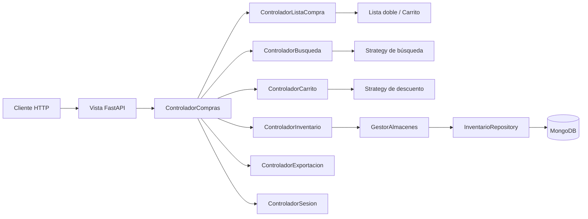
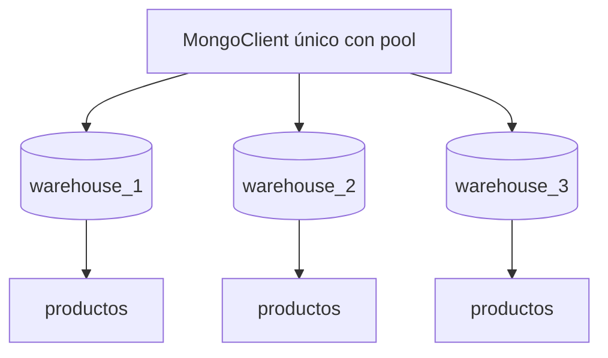

# Arquitectura del Asistente de Compras

Este documento describe la organización MVC, el modelo de datos, la
persistencia por almacén y las decisiones de diseño del backend.

## 1. Vista general



La API es la única superficie de presentación. No hay interfaz Tkinter ni menú
de consola.

## 2. Capas y responsabilidades

| Capa | Directorio | Responsabilidad |
| --- | --- | --- |
| Vista | `views/api/` | FastAPI, validación Pydantic, serialización, errores HTTP, sesiones HTTP. |
| Controlador | `controllers/` | Casos de uso, permisos, coordinación de transacciones y caché. |
| Modelo | `models/` | Entidades, reglas de negocio, estructuras enlazadas, estrategias. |
| Infraestructura | `infrastructure/mongodb/` | Cliente, índices y repositorio concreto. |
| Núcleo | `core/` | Configuración, errores, logging, Observer y resultados tipados. |

Regla de dependencias:

```text
views -> controllers -> models
controllers -> infrastructure (a través del protocolo InventarioRepository)
models -> core (sin FastAPI ni PyMongo)
```

## 3. MVC aplicado

### Modelo

- `Producto`, `ProductoFisico`, `ProductoDigital`, `ProductoSuscripcion`.
- `FabricaProductos` centraliza la construcción y validación.
- `ListaSimple` para inventarios.
- `ListaDoblementeEnlazada` para la lista de compras y el carrito.
- `Almacen` conserva la lista como estructura principal y mantiene índices
  auxiliares `_por_nombre` y `_por_id`.
- `GestorAlmacenes` coordina almacenes, caché y persistencia.
- `CarritoCompras` extiende `SujetoObservable`.

### Controlador

`ControladorCompras` es una fachada compatible con la API anterior. Delega en
controladores pequeños:

- `ControladorSesion`: registro, login, roles y permisos.
- `ControladorListaCompra`: lista sin duplicados.
- `ControladorBusqueda`: ejecuta la estrategia seleccionada.
- `ControladorCarrito`: ítems, descuentos y resumen.
- `ControladorInventario`: altas, precios, CSV y recarga.
- `ControladorExportacion`: CSV de lista y carrito.

Cada sesión HTTP crea su propio `ControladorCompras`, pero todos comparten el
mismo `GestorAlmacenes` y, por tanto, la misma caché de inventario.

### Vista

- `views/api/app.py`: composición de FastAPI, CORS, request-id y lifespan.
- `views/api/schemas/`: DTOs de entrada y salida.
- `views/api/serializers.py`: conversión de dominio a JSON.
- `views/api/errors.py`: traducción de errores a respuestas HTTP.
- `views/api/routers/`: endpoints agrupados por recurso.
- `views/api/dependencies.py`: sesión, repositorio y gestor compartidos.

## 4. MongoDB por almacén



- Un `MongoClient` por proceso, no uno por base.
- Una base por almacén: `{MONGODB_DB_PREFIX}_{id}`.
- Una colección `productos` por base.
- `_id` es el `producto_id` estable del dominio.
- Campos normalizados e índices:
  - `nombre_normalizado`
  - `(nombre_normalizado, marca_normalizada)`
- El repositorio convierte documentos a entidades y viceversa; la vista nunca
  ve documentos de Mongo.

### Documento de ejemplo

```json
{
  "_id": "5f0f...",
  "nombre": "Leche",
  "nombre_normalizado": "leche",
  "marca": "Ilolay",
  "marca_normalizada": "ilolay",
  "categoria": "Lacteos",
  "tipo": "normal",
  "precio": 1000,
  "creado_en": "2026-01-01T00:00:00Z",
  "actualizado_en": "2026-01-02T00:00:00Z"
}
```

## 5. Caché y consistencia

1. Al crear la aplicación se construye el `MongoInventarioRepository`.
2. `GestorAlmacenes.cargar_inventarios()` carga todos los almacenes una vez.
3. Las búsquedas trabajan contra memoria bajo `GestorAlmacenes.candado`.
4. Las altas y ediciones persisten primero en MongoDB y después actualizan la
   caché. Si Mongo falla, la operación no modifica la memoria.
5. `POST /admin/reload` vuelve a leer todos los inventarios desde MongoDB.

No se usan Change Streams ni una segunda colección de comparación. La fuente de
verdad es MongoDB y la caché es una optimización de lectura.

> La caché y las sesiones son locales al proceso. El despliegue por defecto usa
> un único worker de Uvicorn. Para múltiples réplicas se necesitaría un store
> compartido para sesiones y un mecanismo de invalidación de caché.

## 6. Sesiones y permisos

- `RegistroSesiones` crea tokens aleatorios y mantiene un `dict` protegido por
  lock.
- TTL deslizante: cada acceso válido actualiza `ultimo_acceso`.
- Límite máximo: al superar `MAX_SESSIONS` se expulsa la sesión menos usada.
- El token se acepta en la ruta o en `Authorization: Bearer`.
- Los roles son `INVITADO`, `CLIENTE` y `ADMIN`.
- La matriz de permisos vive en `models/permisos.py`.
- `ADMIN_CLAVE` se compara con `secrets.compare_digest` y es obligatoria.

## 7. Resultado de casos de uso

Los controladores devuelven `Resultado`, un `str, Enum`:

```python
Resultado.OK == "ok"  # compatibilidad con la API anterior
bool(Resultado.OK) is True
bool(Resultado.DENEGADO) is False
```

La vista traduce cada valor a un código HTTP:

| Resultado | HTTP |
| --- | --- |
| `OK` | 200/201 |
| `VACIO` | 400 |
| `INVALIDO` | 400/422 |
| `DENEGADO` | 403 |
| `NO_ENCONTRADO` | 404 |
| `DUPLICADO` / `CONFLICTO` | 409 |

Los errores de aplicación (`core/errors.py`) y las validaciones de Pydantic se
serializan con el formato:

```json
{
  "error": "Mensaje legible",
  "codigo": "codigo_estable",
  "detalles": {}
}
```

## 8. Patrones

- **Factory Method**: `FabricaProductos.crear_producto`.
- **Strategy**: `BusquedaMejorPrecioStrategy`, `BusquedaCatalogoStrategy`,
  `MejorPrecioGlobalStrategy`, `DescuentoPorcentaje`, `DescuentoFijo`.
- **Observer**: `CarritoCompras` notifica a la vista; en API se usa
  `ObservadorNulo`.
- **Repository**: `InventarioRepository`, `MongoInventarioRepository`,
  `RepositorioNulo`.
- **Facade**: `ControladorCompras`.
- **Dependency Injection**: FastAPI inyecta sesión, gestor y repositorio.

## 9. Pruebas

- `tests/unit/test_listas.py`: estructuras, observer y carrito.
- `tests/unit/test_productos.py`: factory, validaciones y clonado.
- `tests/unit/test_estrategias.py`: búsquedas, descuentos e índices.
- `tests/unit/test_config.py`: variables y prefijos.
- `tests/unit/test_controladores.py`: flujo completo de casos de uso.
- `tests/unit/test_sesiones.py`: TTL, límite y aislamiento.
- `tests/integration/test_api.py`: API con `PersistenciaFalsa`.
- `tests/integration/test_mongodb.py`: aislamiento real, índices y upsert.

Comando principal:

```bash
python -m unittest discover -s tests -t .
```

## 10. Operación

- `/api/v1/health/live`: no toca MongoDB.
- `/api/v1/health/ready`: hace ping a MongoDB.
- Logs con `request_id` en errores no controlados.
- CORS configurable.
- Dockerfile con usuario no root y healthcheck.
- `docker compose --profile tools run --rm seed` para datos de ejemplo.

## 11. Decisiones relevantes

1. **Una base por almacén** para aislamiento físico y consultas independientes.
2. **Un solo MongoClient** para reutilizar el pool de conexiones.
3. **Listas enlazadas como estructura principal** y diccionarios como índices
   auxiliares para búsquedas O(1) por nombre/id.
4. **Caché en memoria** para evitar lecturas repetidas; recarga administrativa.
5. **Persistencia antes de memoria** para no aceptar escrituras que Mongo
   rechazaría.
6. **Sin clave administrativa por defecto**; el arranque falla si falta.
7. **Compatibilidad `/api`** además de `/api/v1`.
8. **Contrato OpenAPI generado** desde FastAPI y validado en CI.
