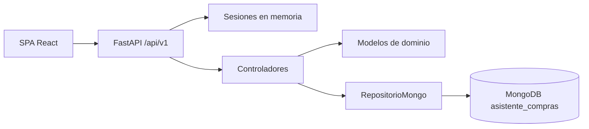
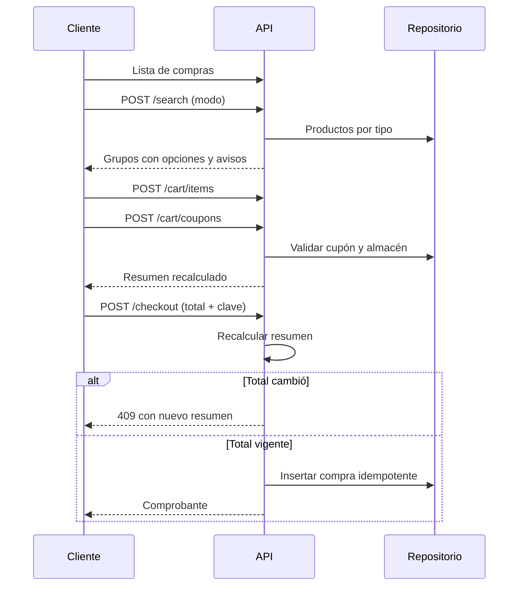

# Arquitectura del Asistente de Compras

## 1. Vista general

La aplicación es una SPA de React servida por la misma API FastAPI. Toda la
persistencia vive en una única base de datos MongoDB llamada `asistente_compras`.
No existen bases por almacén, proyecciones, Change Streams ni procesos auxiliares.



## 2. Capas

| Capa | Directorio | Responsabilidad |
| --- | --- | --- |
| Vista | `views/api/` | FastAPI, validación Pydantic, autenticación Bearer, errores HTTP y servido de la SPA. |
| Controlador | `controllers/` | Casos de uso, permisos y coordinación del carrito, compras y administración. |
| Modelo | `models/` | Entidades, validaciones, carrito y reglas de presentación. |
| Infraestructura | `infrastructure/mongodb/` | Cliente, repositorio, índices y conversión de documentos. |
| Núcleo | `core/` | Configuración por entorno, errores y logging. |

Dependencias:

```text
views -> controllers -> models
controllers -> infrastructure -> MongoDB
```

La vista no accede a MongoDB y los controladores no dependen de FastAPI.

## 3. Roles y autenticación

Roles:

- `CLIENTE`: registro público, lista, búsqueda, carrito, cupones y pago.
- `ADMINISTRADOR_ALMACEN`: productos, CSV, cupones, compras y estadísticas de su
  almacén.
- `ADMINISTRADOR_APP`: almacenes y administradores de almacén.

El login es único. La API devuelve un `session_id` que el cliente envía como
`Authorization: Bearer <session_id>`. Las dependencias de FastAPI comprueban el
rol en cada endpoint; ocultar botones en la interfaz no sustituye esta validación.

La cuenta inicial del administrador de la aplicación se crea en
`RepositorioMongo.inicializar()` solo si no existe ningún usuario con rol
`ADMINISTRADOR_APP`. El correo y la contraseña provienen de `ADMIN_EMAIL` y
`ADMIN_PASSWORD`.

> Las sesiones y los carritos se guardan en memoria del proceso. Por eso el
> contenedor se ejecuta con un solo worker y las sesiones se pierden al
> reiniciar. Es una decisión consciente para esta primera versión.

## 4. Modelo de datos

Una sola base con cinco colecciones:

```text
asistente_compras
├── usuarios
├── almacenes
├── productos
├── cupones
└── compras
```

### `usuarios`

Campos principales: `_id`, `nombre`, `email`, `email_normalizado`,
`password_hash`, `rol`, `almacen_id`, `telefono`, `direccion`, `ciudad`,
`autoriza_datos`, `activo` y `creado_en`.

- `email_normalizado` es único.
- Las contraseñas se guardan con PBKDF2-HMAC-SHA256 y salt aleatorio.
- Un administrador de almacén tiene exactamente un `almacen_id`.

### `almacenes`

`_id`, `nombre`, `nombre_normalizado` único y `creado_en`. No se editan ni
eliminan desde la aplicación.

### `productos`

`_id`, `almacen_id`, `tipo_producto`, `tipo_normalizado`, `nombre`,
`nombre_normalizado`, `marca_variedad`, `marca_normalizada`, `precio`,
`presentacion`, `presentacion_normalizada`, `creado_en` y `actualizado_en`.

Índices:

- `(almacen_id, tipo_normalizado)`
- `(tipo_normalizado, precio)`
- `presentacion_normalizada`

La presentación se valida contra todos los productos del mismo
`tipo_normalizado`, incluso de otros almacenes. Si ya existe una presentación
estándar para el tipo, cualquier alta o edición debe usarla.

### `cupones`

`_id`, `codigo`, `codigo_normalizado` único, `almacen_id`, `porcentaje` y
`creado_en`. El código es único en toda la aplicación. El porcentaje debe estar
en `(0, 100]`.

### `compras`

`_id`, `cliente_id`, `clave_idempotencia`, `cliente_nombre`,
`datos_entrega`, `items`, `por_almacen`, `subtotal`, `descuento_total`, `total`,
`autorizacion_datos`, `pago` y `fecha`.

- `(cliente_id, clave_idempotencia)` es único.
- `items` es una copia inmutable de nombre, presentación, precio, cantidad e
  importe.
- `por_almacen` conserva subtotal, cupón, porcentaje, descuento y total de cada
  almacén.
- `datos_entrega` conserva nombre, teléfono, dirección y ciudad confirmados.

## 5. Flujo de compra



### Búsqueda

El controlador `ControladorCatalogo` recibe la lista y el modo:

1. **`catalogo`**: todas las coincidencias, ordenadas por almacén, nombre de
   producto, precio e identificador.
2. **`mejor_precio`**: el producto más barato de cada almacén para cada término.
   Desempate: nombre de producto y luego identificador.
3. **`global`**: el más barato entre todos los almacenes para cada término.
   Desempate: nombre del almacén, nombre del producto e identificador.

Los filtros usan el precio registrado antes de cupones.

### Carrito y cupones

`ControladorCarrito` mantiene los ítems y códigos de cupón en la sesión y
recalcula el resumen en cada operación:

- Retira productos o almacenes que ya no existen e informa con avisos.
- Valida que el cupón exista y que el carrito tenga productos de su almacén.
- Impide repetir un cupón o acumular dos del mismo almacén.
- Limita la compra a tres cupones.
- Calcula cada descuento sobre el subtotal de su almacén, nunca sobre el total
  general.

### Checkout

`ControladorCompras.comprar()` vuelve a calcular el resumen. Si el cliente envía
`total_esperado` y no coincide, responde `409` con el nuevo resumen para que
confirme otra vez. La compra se inserta con una clave de idempotencia única por
cliente; un reintento con la misma clave devuelve la compra existente en lugar de
duplicarla.

## 6. Administración

### Administrador de almacén

Todas las consultas se filtran por `sesion.almacen_id`. No puede indicar otro
almacén en el cuerpo de la petición.

- Productos: alta, edición completa, eliminación e importación CSV atómica.
- Cupones: alta, listado y eliminación.
- Compras: se proyecta solo la parte del almacén autenticado.
- Estadísticas: unidades vendidas por producto actual, incluyendo los productos
  con cero ventas. Empates alfabéticos por nombre.

### Administrador de la aplicación

Solo puede crear almacenes y administradores de almacén, y actualizar sus
credenciales. No tiene rutas para productos, cupones, compras, estadísticas ni
funciones de cliente.

## 7. Interfaz

`frontend/src/App.jsx` decide la navegación según el rol de la sesión:

- Cliente: lista y carrito.
- Administrador de almacén: productos, cupones, compras y estadísticas.
- Administrador de la aplicación: almacenes y administradores.

`AppContext` conserva la sesión en `localStorage`, valida el token contra
`/auth/me`, gestiona el cierre de sesión y muestra notificaciones. `api.js`
centraliza las llamadas HTTP y normaliza los errores.

En producción, `create_app()` monta `frontend/dist` y sirve `index.html` para las
rutas de la SPA. En desarrollo, Vite redirige `/api` al backend.

## 8. Operación

- `docker compose up -d --build` levanta MongoDB y la aplicación.
- `mongo_data` conserva los datos entre reinicios.
- `docker compose down -v` elimina contenedores y datos.
- La API expone `/api/v1/health/ready` para el healthcheck del contenedor.
- El frontend se compila en una etapa Node del `Dockerfile`.

## 9. Pruebas

- `tests/unit/`: configuración, modelos, sesiones, catálogo y carrito con
  repositorios falsos.
- `tests/integration/`: API y repositorio contra MongoDB real. Se omiten sin
  `MONGODB_URI` y usan una base temporal por prueba.

La integración cubre el flujo completo, los tres filtros, cupones, presentación,
CSV atómico, compras por almacén, estadísticas, idempotencia y restricciones por
rol.
