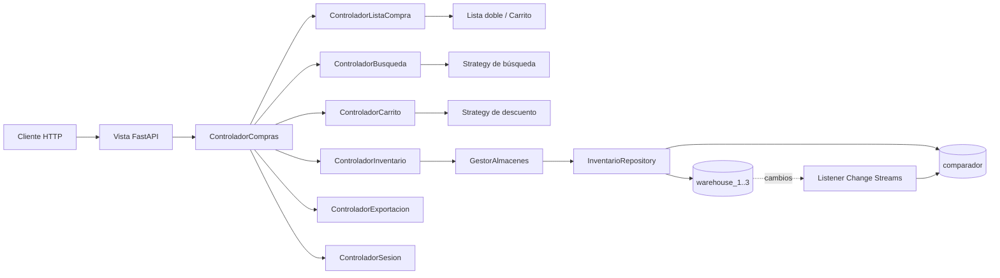
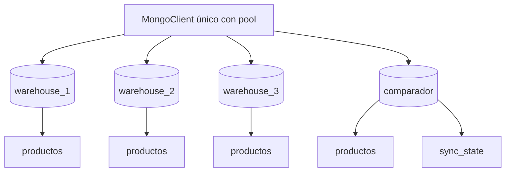

# Arquitectura del Asistente de Compras

Este documento describe la organización MVC, el modelo de datos, la
persistencia por almacén, la base integrada `comparador` y las decisiones de
diseño del backend.

## 1. Vista general



La API es la única superficie de presentación. No hay interfaz Tkinter ni menú
de consola.

## 2. Capas y responsabilidades

| Capa | Directorio | Responsabilidad |
| --- | --- | --- |
| Vista | `views/api/` | FastAPI, validación Pydantic, serialización, errores HTTP, sesiones HTTP. |
| Controlador | `controllers/` | Casos de uso, permisos y coordinación de consultas y escrituras. |
| Modelo | `models/` | Entidades, reglas de negocio, estructuras enlazadas, estrategias y contrato de persistencia. |
| Infraestructura | `infrastructure/mongodb/` | Cliente, documentos, índices, repositorio y proyector `comparador`. |
| Núcleo | `core/` | Configuración, errores, logging, Observer y resultados tipados. |

Regla de dependencias:

```text
views -> controllers -> models
controllers -> infrastructure (a través del protocolo InventarioRepository)
models -> core (sin FastAPI ni PyMongo)
```

## 3. MVC aplicado

### Modelo

- `Producto`, `ProductoFisico`, `ProductoDigital`, `ProductoSuscripcion`.
- `FabricaProductos` centraliza la construcción y validación.
- `ListaSimple` para resultados acotados y usos en memoria.
- `ListaDoblementeEnlazada` para la lista de compras y el carrito.
- `Almacen` representa la metadata del almacén. Conserva una lista enlazada
  para pruebas y usos sin persistencia, con índices auxiliares `_por_nombre` y
  `_por_id`.
- `GestorAlmacenes` coordina los almacenes y delega en el repositorio cuando
  existe. Sin persistencia funciona en memoria para pruebas.
- `CarritoCompras` extiende `SujetoObservable`.

### Controlador

`ControladorCompras` es una fachada compatible con la API anterior. Delega en
controladores pequeños:

- `ControladorSesion`: registro, login, roles y permisos.
- `ControladorListaCompra`: lista sin duplicados.
- `ControladorBusqueda`: consulta `comparador` para `mejor_precio`, `catalogo`
  y `global`.
- `ControladorCarrito`: ítems, descuentos y resumen.
- `ControladorInventario`: altas, precios, baja, CSV, estado y reconciliación.
- `ControladorExportacion`: CSV de lista y carrito.

Cada sesión HTTP crea su propio `ControladorCompras`, pero todos comparten el
mismo `GestorAlmacenes` y el mismo repositorio. El catálogo no se comparte en
memoria porque no se carga completo.

### Vista

- `views/api/app.py`: composición de FastAPI, CORS, request-id y lifespan.
- `views/api/schemas/`: DTOs de entrada y salida.
- `views/api/serializers.py`: conversión de dominio a JSON.
- `views/api/errors.py`: traducción de errores a respuestas HTTP.
- `views/api/routers/`: endpoints agrupados por recurso.
- `views/api/dependencies.py`: sesión, repositorio y gestor compartidos.

## 4. MongoDB: almacenes y comparador



- Un `MongoClient` por proceso, no uno por base.
- Una base por almacén: `{MONGODB_DB_PREFIX}_{id}`. Es la fuente de verdad.
- Una colección `productos` por base de almacén.
- `_id` es el `producto_id` estable del dominio.
- Campos normalizados e índices:
  - `nombre_normalizado`
  - `(nombre_normalizado, marca_normalizada)`
- La base `{MONGODB_COMPARADOR_DB}` contiene el read model y su estado.
- El repositorio convierte documentos a entidades y viceversa; la vista nunca
  ve documentos de Mongo.

### Documento de almacén

```json
{
  "_id": "5f0f...",
  "nombre": "Leche",
  "nombre_normalizado": "leche",
  "marca": "Ilolay",
  "marca_normalizada": "ilolay",
  "categoria": "Lacteos",
  "tipo": "normal",
  "precio": 1000,
  "creado_en": "2026-01-01T00:00:00Z",
  "actualizado_en": "2026-01-02T00:00:00Z"
}
```

### Documento integrado

```json
{
  "_id": "1_5f0f...",
  "producto_id": "5f0f...",
  "almacen_id": 1,
  "almacen_nombre": "Almacen 1",
  "nombre": "Leche",
  "nombre_normalizado": "leche",
  "marca": "Ilolay",
  "marca_normalizada": "ilolay",
  "categoria": "Lacteos",
  "tipo": "normal",
  "precio": 1000,
  "precio_final": 1000,
  "sincronizado_en": "2026-01-02T00:00:00Z"
}
```

El `_id` compuesto `"{almacen_id}_{producto_id}"` permite que el mismo nombre
exista en varios almacenes con identificadores distintos.

Índices de `comparador.productos`:

- `(nombre_normalizado, precio_final)`
- `(almacen_id, nombre_normalizado, precio_final)`
- `producto_id`
- `almacen_id`

## 5. Sincronización con Change Streams

MongoDB debe ejecutarse como **replica set**. El proceso
`scripts/run_listener.py` usa `SincronizadorComparador`:

1. Si no existe `resume_token`, reconstruye `comparador` desde los almacenes.
2. Abre un Change Stream sobre `warehouse_* .productos`.
3. Aplica `insert`, `update`, `replace` y `delete` de forma idempotente.
4. Guarda el `resume_token` y el estado en `comparador.sync_state`.
5. Ante `ChangeStreamHistoryLost` (código 286), reconstruye y reabre el stream.
6. Reintenta con backoff si se pierde la conexión.

La reconciliación usa una marca `_reconciliacion` por ejecución para eliminar
documentos obsoletos sin mantener en memoria todos los ids del catálogo. El
borrado solo afecta a documentos con `sincronizado_en` anterior al inicio de la
reconciliación, de modo que un evento aplicado por otro proceso mientras tanto
no se pierde.

La consistencia es eventual. La API no proyecta cambios de forma síncrona: el
administrador escribe en `warehouse_*` y el listener actualiza `comparador`.

## 6. Consultas sin caché del catálogo

La API no carga inventarios completos al arrancar. Las consultas se resuelven
en MongoDB con índices y límites:

| Consulta | Fuente | Implementación |
| --- | --- | --- |
| Listado por almacén | `warehouse_X` | `find().sort().skip().limit()` y `X-Total-Count`. |
| `mejor_precio` | `comparador` | Agregación agrupada por almacén y nombre. |
| `catalogo` | `comparador` | `find()` paginado con `limit` y `offset`. |
| `global` | `comparador` | Agregación: el más barato por nombre. |
| Carrito por `producto_id` | `warehouse_X` | `find_one` indexado por `_id`. |
| Estado del listener | `comparador.sync_state` | Documento `_id = "global"`. |

No se cachea `comparador` completo. La memoria por petición queda acotada por
`limit` y por el tamaño de la lista de compras del usuario.

Las listas enlazadas se mantienen para la lista de compras, el carrito y los
resultados acotados de una consulta. Las sesiones siguen en memoria, por lo que
el despliegue recomendado usa un único worker de Uvicorn.

## 7. Sesiones y permisos

- `RegistroSesiones` crea tokens aleatorios y mantiene un `dict` protegido por
  lock.
- TTL deslizante: cada acceso válido actualiza `ultimo_acceso`.
- Límite máximo: al superar `MAX_SESSIONS` se expulsa la sesión menos usada.
- El token se acepta en la ruta o en `Authorization: Bearer`.
- Los roles son `INVITADO`, `CLIENTE` y `ADMIN`.
- La matriz de permisos vive en `models/permisos.py`.
- `ADMIN_CLAVE` se compara con `secrets.compare_digest` y es obligatoria.

## 8. Resultado de casos de uso

Los controladores devuelven `Resultado`, un `str, Enum`:

```python
Resultado.OK == "ok"  # compatibilidad con la API anterior
bool(Resultado.OK) is True
bool(Resultado.DENEGADO) is False
```

La vista traduce cada valor a un código HTTP:

| Resultado | HTTP |
| --- | --- |
| `OK` | 200/201 |
| `VACIO` | 400 |
| `INVALIDO` | 400/422 |
| `DENEGADO` | 403 |
| `NO_ENCONTRADO` | 404 |
| `DUPLICADO` / `CONFLICTO` | 409 |

Los errores de aplicación (`core/errors.py`) y las validaciones de Pydantic se
serializan con el formato:

```json
{
  "error": "Mensaje legible",
  "codigo": "codigo_estable",
  "detalles": {}
}
```

## 9. Patrones

- **Factory Method**: `FabricaProductos.crear_producto`.
- **Strategy**: `BusquedaMejorPrecioStrategy`, `BusquedaCatalogoStrategy`,
  `MejorPrecioGlobalStrategy`, `DescuentoPorcentaje`, `DescuentoFijo`.
- **Observer**: `CarritoCompras` notifica a la vista; en API se usa
  `ObservadorNulo`.
- **Repository**: `InventarioRepository`, `MongoInventarioRepository`,
  `RepositorioNulo`.
- **Facade**: `ControladorCompras`.
- **Dependency Injection**: FastAPI inyecta sesión, gestor y repositorio.

## 10. Pruebas

- `tests/unit/test_listas.py`: estructuras, observer y carrito.
- `tests/unit/test_productos.py`: factory, validaciones y clonado.
- `tests/unit/test_estrategias.py`: búsquedas, descuentos e índices.
- `tests/unit/test_comparador.py`: documentos, `_id` compuesto y pipeline.
- `tests/unit/test_config.py`: variables, prefijos y base integrada.
- `tests/unit/test_controladores.py`: flujo completo de casos de uso.
- `tests/unit/test_sesiones.py`: TTL, límite y aislamiento.
- `tests/integration/test_api.py`: API con `PersistenciaFalsa`.
- `tests/integration/test_mongodb.py`: MongoDB real, réplica, paginación,
  reconciliación y Change Streams.

Comando principal:

```bash
python -m unittest discover -s tests -t .
```

Con MongoDB real en replica set:

```bash
docker compose up -d mongodb mongo-init
MONGODB_URI='mongodb://127.0.0.1:27017/?directConnection=true' \
  ADMIN_CLAVE=test-admin-key \
  python -m unittest discover -s tests -t . -v
```

## 11. Operación

- `/api/v1/health/live`: no toca MongoDB.
- `/api/v1/health/ready`: hace ping a MongoDB.
- `scripts/run_listener.py`: listener único; se reinicia solo en Docker.
- `scripts/reconciliar_comparador.py`: reconstrucción manual.
- `GET /admin/comparador/status`: estado, documentos y último evento.
- `POST /admin/comparador/reconciliar`: fuerza la reconstrucción.
- `POST /admin/reload`: alias de compatibilidad para reconciliar.
- Logs con `request_id` en errores no controlados.
- CORS configurable.
- Dockerfile con usuario no root y healthcheck.
- `docker compose --profile tools run --rm seed` para datos de ejemplo.

Orden de arranque:

```text
mongodb (--replSet rs0)
    -> mongo-init (rs.initiate o rs.reconfig al host anunciado)
    -> seed (opcional)
    -> listener
    -> app
```

`mongo-init` comprueba el host anunciado por el replica set y aplica
`rs.reconfig({ force: true })` si el volumen existente apunta a otro hostname
(por ejemplo `localhost:27017`, inalcanzable desde otros contenedores). El host
se controla con `MONGO_REPLICA_HOST` y por defecto es `mongodb:27017`.

En CI el replica set se arranca con `docker run --network host`, se inicia con
`rs.initiate({ host: "127.0.0.1:27017" })` y las pruebas usan
`MONGODB_URI=mongodb://127.0.0.1:27017/?replicaSet=rs0`.

## 12. Decisiones relevantes

1. **Una base por almacén** para aislamiento físico y consultas independientes.
2. **Una base integrada `comparador`** para búsquedas globales indexadas.
3. **Change Streams** para mantener la proyección sin acoplar la API al
   listener.
4. **Sin caché del catálogo**; paginación y consultas con índices.
5. **`_id` compuesto** para que un mismo producto coexista en varios almacenes.
6. **`precio_final` proyectado** para no recalcular envío o suscripción en cada
   consulta.
7. **Reconciliación reconstruible**; `comparador` no es la única copia.
8. **Sin clave administrativa por defecto**; el arranque falla si falta.
9. **Compatibilidad `/api`** además de `/api/v1`.
10. **Contrato OpenAPI generado** desde FastAPI y validado en CI.
