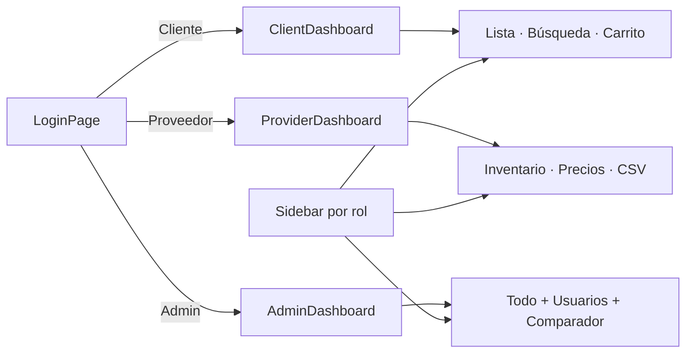

# Requisitos

### Overview
Transformar el frontend de **consola de prueba API** a una **aplicación para usuarios finales** donde cada tipo de usuario (cliente, proveedor, admin) ve solo lo que le corresponde, sin información técnica de APIs, rutas HTTP, respuestas JSON, ni configuraciones de servidor.

### User Stories
- **Como cliente**, quiero iniciar sesión con mi nombre, buscar productos, agregarlos a mi lista y carrito, y comparar precios sin ver nada técnico.
- **Como proveedor**, quiero iniciar sesión y gestionar mi inventario (productos, precios, importar CSV) sin ver información de APIs.
- **Como admin**, quiero iniciar sesión con mi clave y acceder a todas las funciones incluyendo gestión de usuarios, sin ver rutas HTTP ni JSON.

### Scope

#### In Scope
- Página de login unificada con selector de tipo de cuenta
- Sidebar personalizado por rol (cada rol ve solo sus secciones)
- Dashboard personalizado por rol con resumen relevante
- Limpieza de toda información API (rutas HTTP, JSON responses, health checks, tokens visibles, endpoint maps)
- Eliminación de páginas puramente técnicas (RolesPage, ExportsPage con mapa de endpoints)
- Topbar y footer limpios sin referencias a APIs

#### Out of Scope
- Cambios al backend
- Registro de nuevos usuarios (se mantiene el flujo actual de sesión por nombre/clave)
- Autenticación con contraseña (se mantiene el modelo actual)

# Diseño Técnico

### Current Implementation
La aplicación es una **consola integral API** con:
- `App.jsx`: Shell principal con navegación por hash, Topbar que muestra `apiBase` y tokens, footer con referencia a `/api/v1`
- `Sidebar.jsx`: Navegación con `ApiSettings` (URL configurable, link a Swagger docs), subtítulo "Consola API v1"
- `Dashboard.jsx`: Health checks, endpoint coverage, API base stats, Swagger link
- `SessionPage.jsx`: 3 formularios con rutas API visibles (`POST /sessions/user`), JSON responses, token copy
- `RolesPage.jsx`: Catálogo de roles con gestión de usuarios, rutas API en descriptions
- `AdminPage.jsx`: CRUD de productos con rutas API en cada Card description, JsonBlock responses
- `SearchPage.jsx`: Búsqueda con parámetros técnicos (modo, limit, offset), JsonBlock
- `CartPage.jsx`: Carrito con rutas API en descriptions, JsonBlock
- `ShoppingListPage.jsx`: Lista con rutas API, JsonBlock
- `WarehousesPage.jsx`: Inventario con rutas API, parámetros técnicos
- `ExportsPage.jsx`: Exportaciones + **tabla completa de ENDPOINTS**
- `api.js`: `ENDPOINTS` array exportado usado en Dashboard y ExportsPage
- `AppContext.jsx`: Contexto con `apiBase`, `docs` (Swagger URL), `changeApiBase`
- `ui.jsx`: `JsonBlock`, `NeedSession`, `NeedPermission`, `NeedAdmin` (todos con lenguaje técnico)

### Key Decisions
1. **Login unificado**: Un solo componente `LoginPage` con selector de tipo (cliente/proveedor/admin) que reemplaza `SessionPage`. Mantiene las 3 llamadas API pero sin mostrar rutas.
2. **Sidebar por rol**: `NAV_ITEMS` se filtra dinámicamente según `session.rol`. Cada rol tiene su propio conjunto de items.
3. **Dashboard por rol**: Un componente `Dashboard` que renderiza secciones diferentes según el rol usando los datos existentes.
4. **Eliminación de ENDPOINTS**: Se remueve el export de `ENDPOINTS` de `api.js` y todo su consumo.
5. **Limpieza progresiva**: Cada página se limpia de referencias API manteniendo su funcionalidad.

### Proposed Changes

#### Nuevos componentes
- `src/pages/LoginPage.jsx`: Login unificado con selector de tipo de cuenta
- `src/pages/ClientDashboard.jsx`: Dashboard para clientes (lista, carrito, accesos rápidos)
- `src/pages/ProviderDashboard.jsx`: Dashboard para proveedores (inventario, accesos rápidos)
- `src/pages/AdminDashboard.jsx`: Dashboard para admins (estadísticas, gestión, accesos rápidos)

#### Modificaciones
- `App.jsx`: Reemplazar `SessionPage` por `LoginPage`, eliminar Topbar técnico, limpiar footer
- `Sidebar.jsx`: Eliminar `ApiSettings`, cambiar subtítulo, filtrar items por rol
- `Dashboard.jsx`: Reemplazar por lógica que renderiza el dashboard según rol
- `api.js`: Eliminar export de `ENDPOINTS`, `docsUrl()`, `saveApiBase()`, `normalizeApiBase()`
- `AppContext.jsx`: Eliminar `apiBase`, `changeApiBase`, `docs` del contexto
- `SearchPage.jsx`: Limpiar de rutas API, JsonBlock, parámetros técnicos
- `CartPage.jsx`: Limpiar de rutas API, JsonBlock
- `ShoppingListPage.jsx`: Limpiar de rutas API, JsonBlock
- `WarehousesPage.jsx`: Limpiar de rutas API
- `AdminPage.jsx`: Limpiar de rutas API, JsonBlock
- `ui.jsx`: Actualizar `NeedSession`, `NeedPermission`, `NeedAdmin` con lenguaje amigable; eliminar `JsonBlock`

#### Eliminaciones
- `src/pages/SessionPage.jsx`: Reemplazado por `LoginPage`
- `src/pages/RolesPage.jsx`: No necesario para usuarios finales
- `src/pages/ExportsPage.jsx`: Exportaciones integradas en las páginas correspondientes

### File Structure
```
src/
├── api.js (modificado: sin ENDPOINTS, sin docsUrl)
├── App.jsx (modificado: login unificado, topbar limpio)
├── context/
│   └── AppContext.jsx (modificado: sin apiBase/docs)
├── components/
│   ├── Sidebar.jsx (modificado: sin ApiSettings, por rol)
│   └── ui.jsx (modificado: sin JsonBlock, mensajes amigables)
└── pages/
    ├── LoginPage.jsx (nuevo: login unificado)
    ├── ClientDashboard.jsx (nuevo)
    ├── ProviderDashboard.jsx (nuevo)
    ├── AdminDashboard.jsx (nuevo)
    ├── Dashboard.jsx (modificado: router por rol)
    ├── SearchPage.jsx (limpiado)
    ├── CartPage.jsx (limpiado)
    ├── ShoppingListPage.jsx (limpiado)
    ├── WarehousesPage.jsx (limpiado)
    ├── AdminPage.jsx (limpiado)
    ├── SessionPage.jsx (eliminado)
    ├── RolesPage.jsx (eliminado)
    └── ExportsPage.jsx (eliminado)
```

### Architecture Diagram


### Risks
- **Compatibilidad con backend**: Las llamadas API se mantienen igual, solo cambia la UI. Riesgo bajo.
- **Sesiones existentes**: Las sesiones guardadas en localStorage mantienen su estructura. Se migran limpiamente.
- **Permisos**: El sistema de permisos (`can()`) se mantiene intacto para controlar acceso.

# Testing

### Validation Approach
Verificar que cada rol ve solo sus secciones y que la funcionalidad se mantiene.

### Key Scenarios
1. **Login como cliente**: Iniciar sesión → ver dashboard de cliente → navegar a lista, búsqueda, carrito → no ver admin ni roles
2. **Login como proveedor**: Iniciar sesión → ver dashboard de proveedor → gestionar inventario → no ver carrito ni búsqueda
3. **Login como admin**: Iniciar sesión → ver dashboard de admin → acceso a todas las secciones
4. **Cerrar sesión**: Cerrar → volver a login → sesión limpia
5. **Navegación**: Sidebar muestra solo items del rol activo

### Edge Cases
- Sin sesión: redirigir a login
- Sesión expirada: notificar y redirigir a login
- Cambiar de rol: cerrar sesión primero, luego login con otro tipo

# Delivery Steps

### ✓ Step 1: Crear LoginPage unificado y dashboards por rol
Crear los nuevos componentes de login y dashboards personalizados.
- Crear `LoginPage.jsx` con selector de tipo (cliente/proveedor/admin) y formularios limpios sin rutas API
- Crear `ClientDashboard.jsx` con resumen de lista, carrito, y accesos rápidos a búsqueda
- Crear `ProviderDashboard.jsx` con resumen de inventario y accesos a gestión
- Crear `AdminDashboard.jsx` con estadísticas generales, gestión de usuarios, y accesos completos
- Modificar `Dashboard.jsx` para renderizar el dashboard según el rol actual

### ✓ Step 2: Reestructurar App, Sidebar y Contexto
Actualizar la estructura principal de la aplicación para eliminar información API.
- Modificar `App.jsx`: reemplazar `SessionPage` por `LoginPage`, limpiar Topbar (quitar `apiBase`, tokens, Swagger), limpiar footer
- Modificar `Sidebar.jsx`: eliminar `ApiSettings`, cambiar subtítulo a nombre de la app, filtrar `NAV_ITEMS` por rol
- Modificar `AppContext.jsx`: eliminar `apiBase`, `changeApiBase`, `docs` del contexto
- Modificar `api.js`: eliminar export de `ENDPOINTS`, `docsUrl()`, `saveApiBase()`, `normalizeApiBase()`
- Eliminar `SessionPage.jsx`, `RolesPage.jsx`, `ExportsPage.jsx`

### ✓ Step 3: Limpiar todas las páginas de referencias API
Eliminar rutas HTTP, JsonBlock, y lenguaje técnico de todas las páginas restantes.
- `SearchPage.jsx`: quitar rutas API de descriptions, eliminar JsonBlock, simplificar parámetros
- `CartPage.jsx`: quitar rutas API, eliminar JsonBlock, limpiar descriptions
- `ShoppingListPage.jsx`: quitar rutas API, eliminar JsonBlock, limpiar descriptions
- `WarehousesPage.jsx`: quitar rutas API de descriptions, limpiar lenguaje técnico
- `AdminPage.jsx`: quitar rutas API de Card descriptions, eliminar JsonBlock, limpiar lenguaje
- `ui.jsx`: actualizar `NeedSession`, `NeedPermission`, `NeedAdmin` con mensajes amigables; eliminar `JsonBlock`

### ✓ Step 4: Ajustes finales y verificación
Verificar consistencia y pulir la experiencia de usuario.
- Verificar que las importaciones eliminadas se limpian en todos los archivos
- Asegurar que la navegación funciona correctamente entre páginas
- Verificar que cada rol ve solo sus secciones en el sidebar
- Confirmar que no quedan referencias a APIs, endpoints, o JSON en la UI visible
- Revisar que los mensajes de error y notificaciones son amigables

### ✓ Step 5: Login como pantalla única sin layout
Hacer que el login sea la única pantalla visible cuando no hay sesión activa.
- Modificar `App.jsx`: cuando no hay sesión, mostrar solo `LoginPage` sin Sidebar, Topbar ni Footer
- Limpiar el hash de URL al no haber sesión para evitar rutas internas visibles
- Pasar `onNavigate` al `LoginPage` para redirigir al dashboard tras iniciar sesión
- El hash se restaura automáticamente al cerrar sesión y volver al login

### ✓ Step 6: Flujo de tienda para clientes
Transformar la experiencia del cliente en un flujo de tienda de 2 pasos: crear lista → ver productos → carrito.
- Crear `StorePage.jsx`: componente principal con 2 fases (paso 1: crear lista, paso 2: ver productos y carrito)
- Paso 1: Formulario para agregar productos a la lista (input con botón agregar, lista de items con opción de eliminar)
- Paso 2: Al dar continuar, buscar productos basados en la lista y mostrar resultados agrupados por almacén con precios
- Desde los productos mostrados, el cliente puede agregar al carrito con un clic
- Panel lateral con resumen del carrito siempre visible en el paso 2
- Opción de ordenar productos por precio más bajo, nombre, o almacén
- Actualización dinámica: al modificar la lista, los productos se actualizan automáticamente
- Modificar `ClientDashboard.jsx` para redirigir al flujo de tienda
- Actualizar `Sidebar.jsx` para que el cliente vea "Tienda" como opción principal
- Las páginas separadas (lista, búsqueda) se mantienen para navegación directa por hash